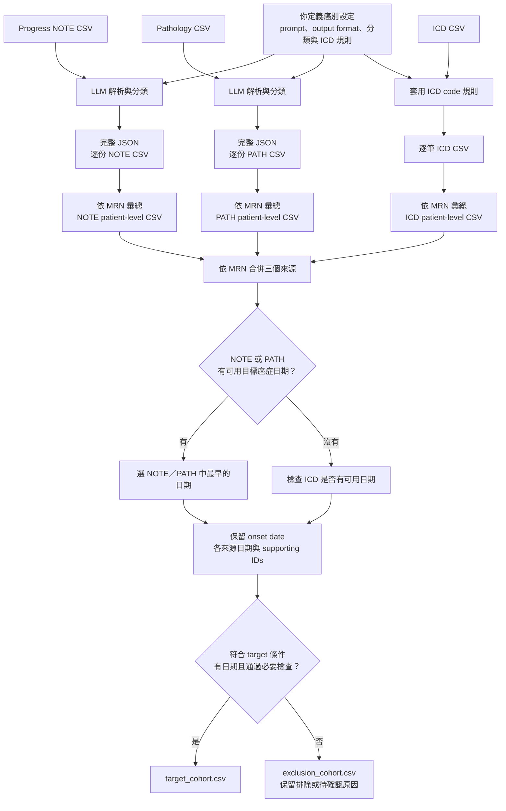

# Cancer Report Parser

把 **Progress NOTE、Pathology report 和 ICD 紀錄**整理成可追溯的病人層級癌症資料。

同一套程式可以用於不同癌別。你定義 **prompt、分類規則、output format 和 ICD 清單**，程式負責執行、驗證、續跑、合併與匯出。

目前已有 ovarian 設定，breast 提供待填寫範本。

## 整個流程怎麼走



**每份報告先解析，再依 MRN 彙總。** 同一位病人的多份報告會一起提供日期證據，各份原始結果和來源 ID 都會保留。

## 換一個癌別，你要定義什麼

每個癌別有一份設定檔，例如 [ovarian.json](profiles/ovarian.json)。新增 breast 時，從 [breast.example.json](profiles/breast.example.json) 開始。

- **Target 範圍**。哪些 primary origins 屬於這個研究。
- **NOTE prompt**。要擷取什麼、怎麼分類、診斷日期怎麼選。
- **PATH prompt**。病理標本、診斷、原發部位與分類的規則。
- **Output format**。用 JSON Schema 定義欄位、型別和允許值，可以額外加入你的研究欄位。
- **ICD 清單**。哪些 codes 支持 target，哪些只作輔助，以及日期欄位怎麼讀。

程式需要從你的輸出中對應出五個欄位，才能進行後續合併。

```text
病人 ID → MRN
來源 ID → note ID 或 report ID
文件日期 → 看診或報告日期
分類 → 這份資料的分類結果
診斷日期 → 這份資料提供的日期證據
```

欄位可以自行命名，在設定檔的 `output_fields` 指定對應即可。新癌別的 JSON Schema 會自動加入 prompt，回覆後也會再驗證一次。

目前 ovarian 使用 Malignant、Borderline、Benign、Other、Uncertain 五分類。Breast 的 prompt、schema 和 ICD 規則需填寫並確認後，才能正式執行。

[查看癌別設定方式與 output format 範例 →](profiles/README.md)

## 最後會拿到什麼

- **完整解析結果**。壓縮 JSONL 保存你定義的全部欄位，每行一份報告。
- **Record-level CSV**。每份 NOTE、PATH 或每筆 ICD 的摘要，包含分類、日期、來源與處理狀態。
- **Patient-level CSV**。每個來源依 MRN 彙總，保留日期、支持日期的來源 ID 和待核原因。
- **兩份最終 CSV**。Target cohort，以及附原因的 exclusion／review cohort。

例如，跑完 NOTE 後：

```text
runs/ovarian-note/
├── note/
│   ├── batch_0001.jsonl.gz
│   └── batch_0002.jsonl.gz
├── csv/
│   ├── note_record_level.csv
│   └── note_patient_level.csv
├── ledger.sqlite3       # 原始模型回覆、用量與錯誤紀錄
└── manifest.json        # 進度與完成狀態
```

最終 `target_cohort.csv` 的欄位依序為：

```text
MRN, onset_date, source,
pathology_positive_date, progress_note_positive_date, icd10_positive_date,
in_pathology, in_progress_note, in_icd10,
pathology_source_id, progress_note_source_id, icd10_source_id
```

Exclusion CSV 另外保留各來源分類、待核原因和 `exclusion_reason`。這份清單也可能包含證據不足或缺日期、需要確認的病人。

## 日期怎麼選

**先使用 NOTE／PATH 的日期。只有這兩個來源都沒有可用日期時，才使用 ICD 日期。**

例如，NOTE 寫初診是 2001、PATH 提供 2003、ICD 是 1998，最後選 **2001**。

若報告明寫「2001 年確診，2021 年復發」，保留 **2001**。若只有復發日期、初診日期未知，初診日期維持空白。日期只知道年份或月份時，保留原有精度，例如 `2001` 或 `2001-06`。

只有符合 target-positive 規則的日期會進入 target onset。其餘分類的日期仍保存在逐份結果裡，方便查驗。

## 開始使用

### 1. 安裝並查看癌別設定

```bash
python3 -m venv .venv
.venv/bin/python -m pip install --upgrade pip
.venv/bin/python -m pip install -e .

.venv/bin/python -m cancer_pipeline check-study --study profiles/ovarian.json
```

Python 3.9+，支援 macOS 和 Linux。模型與 gateway 設定參考 [config.example.json](config.example.json)，金鑰存在本機 `config.local.json` 或環境變數。

### 2. 先檢查一份來源 CSV

```bash
.venv/bin/python -m cancer_pipeline run \
  --study profiles/ovarian.json --module note \
  --source data/notes.csv \
  --config config.example.json \
  --output-dir runs/ovarian-note
```

這一步只做本機檢查。正式推論時改用已設定金鑰與核准 endpoint 的 `config.local.json`，並加上 `--execute --budget-usd 20`。金額可自行設定，代表按設定費率估算的停機線；實際帳單需向 gateway 核對。

PATH 使用相同指令，改成 `--module path`、對應的來源 CSV 和獨立輸出資料夾。重新執行相同指令可以接續原有進度。

### 3. 處理 ICD

```bash
.venv/bin/python -m cancer_pipeline icd \
  --study profiles/ovarian.json --source data/icd.csv \
  --output-dir runs/ovarian-icd
```

### 4. 合併已完成的三個來源

```bash
.venv/bin/python -m cancer_pipeline merge \
  --study profiles/ovarian.json \
  --note runs/ovarian-note/csv/note_patient_level.csv \
  --path runs/ovarian-path/csv/path_patient_level.csv \
  --icd runs/ovarian-icd/csv/icd_patient_level.csv \
  --output-dir runs/ovarian-cohorts
```

資料需自行放入 `data/`。原始資料、金鑰和執行結果由 Git 忽略。

## 需要更多細節

- [完整操作流程](docs/reusable_workflow.md) 包含續跑、錯誤處理、離線 JSON 彙總與驗證。
- [癌別設定指南](profiles/README.md) 說明 prompt、schema 和欄位對應。
- [Ovarian 舊版指令與試跑紀錄](docs/legacy_ovarian_commands.md) 保留既有執行流程和歷史說明。人工 PATH 覆核紀錄目前由這套既有流程讀取。

本機測試指令：

```bash
.venv/bin/python -m unittest discover -s tests
```
