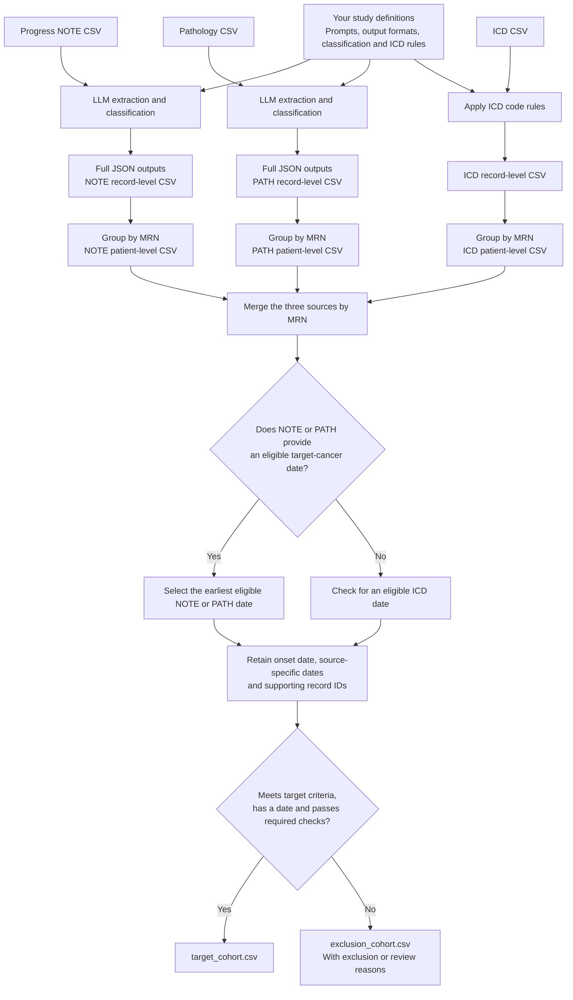

# Cancer Parser for Clinical Report

Turn **progress notes, pathology reports, and ICD records** into traceable patient-level cancer data.

Use the same workflow across cancer types. You define the **prompts, classification rules, output formats, and ICD code lists**. The pipeline handles inference, validation, resuming runs, aggregation, and exports.

An ovarian study profile is included. A breast study template is available for you to complete.

## How the workflow runs



**Parse each document first, then aggregate by MRN.** Multiple documents from the same patient can contribute date evidence. Individual outputs and source IDs remain available for review.

## What you define for each cancer type

Each study has a configuration file, such as [ovarian.json](profiles/ovarian.json). Start a breast study from [breast.example.json](profiles/breast.example.json).

- **Target scope** identifies the primary origins included in your study.
- **NOTE prompt** defines what to extract, how to classify it, and how to select diagnosis dates.
- **PATH prompt** defines specimen, diagnosis, primary-origin, and classification rules.
- **Output format** uses JSON Schema to define fields, types, and allowed values. Add the fields your study needs.
- **ICD rules** identify positive codes, auxiliary codes, and the source date fields.

Map five fields from your output into the shared workflow.

```text
Patient ID      → MRN
Source ID       → Note ID or report ID
Document date   → Encounter or report date
Classification  → The record's assigned category
Diagnosis date  → The date supported by that record
```

You can choose your own field names and map them through `output_fields`. For custom formats, choose Structured Outputs to send your JSON Schema as an API constraint, or JSON mode to include it in the prompt. Both modes validate the returned output locally.

The ovarian profile uses Malignant, Borderline, Benign, Other, and Uncertain. Complete and review the breast prompts, schemas, and ICD rules before executing that study.

[Read the study configuration guide and output-format example →](profiles/README.md)

## Define a different output format with Structured Outputs

Copy [breast.example.json](profiles/breast.example.json) to a new study profile. NOTE and PATH can each use a different schema. The example remains a draft until you supply and review its clinical definitions.

1. **Write clinical instructions** in `prompts/breast/note.txt` and `prompts/breast/path.txt`: target origins, classifications, subtype vocabulary, diagnosis inclusion, and date selection. These rules belong in the prompt even when using a strict schema.
2. **Define the output shape** in `schemas/breast/note.schema.json` and `schemas/breast/path.schema.json`: keys, nesting, types, enums, and nullable values. Start from [this minimal schema](schemas/examples/custom_record.schema.json), then add your study's fields.
3. **Connect the files** in your study profile. Paths resolve relative to the profile file. For example, configure `modules.note` with the following fields (retain its other input/model settings):

```json
{
  "prompt": "../prompts/breast/note.txt",
  "response_mode": "structured",
  "validator": "json_schema",
  "output_schema": "../schemas/breast/note.schema.json",
  "aggregation": "classification",
  "output_fields": {
    "patient_id": "mrn",
    "source_id": "record_id",
    "document_date": "document_date",
    "classification": "classification",
    "diagnosis_date": "diagnosis_date"
  }
}
```

Repeat for `modules.path` with its PATH prompt and schema. If you rename the five common evidence fields, update `output_fields` to match. Additional nested fields are preserved in the JSONL; the summary CSV uses the mapped evidence fields.

**Strict schema requirements:** use an object at the root, set `additionalProperties: false` on every object, and list every property in `required`. Represent missing scalar values with a nullable type such as `["string", "null"]`; define array `items` and use `[]` for empty lists. Define allowed labels with `enum`. The local preflight rejects common unsupported schema constructs; the gateway/model must also support the submitted schema. See the [official Structured Outputs guide](https://developers.openai.com/api/docs/guides/structured-outputs?api-mode=chat).

In structured mode, the runner sends the schema through `response_format` with `strict: true`, without appending a duplicate schema to the custom prompt. You can remove a redundant JSON-format example from that prompt, while retaining all clinical interpretation and missing-value rules. Source metadata is restored from the input, and schema/date validation still runs locally. Existing ovarian validators also retain their clinical cross-field checks when a strict schema is supplied.

**Format compliance does not establish clinical correctness or guarantee lower cost.** Review classification and diagnosis-date accuracy separately. Refusals, truncated answers, and schema failures are recorded rather than exported as valid predictions. An unsupported gateway response does not trigger an automatic fallback to JSON mode.

The existing `profiles/ovarian.json` and legacy production commands retain their original JSON mode. New study templates select structured mode explicitly. After changing a prompt or schema, use a new run directory: resume rejects changed study artifacts to avoid mixing experiments. Validate your configuration locally with `check-study` and a dry-run `run` before authorizing paid inference.

## What you get

- **Full extraction outputs** in compressed JSONL, preserving all fields in your format, with one report per line.
- **Record-level CSVs** containing a summary for each document or ICD record, including classification, dates, source, and processing status.
- **Patient-level CSVs** for each source, containing the selected date, supporting source IDs, and review reasons.
- **Two final CSVs** containing the target cohort and the exclusion/review cohort.

For example, a completed NOTE run produces:

```text
runs/ovarian-note/
├── note/
│   ├── batch_0001.jsonl.gz
│   └── batch_0002.jsonl.gz
├── csv/
│   ├── note_record_level.csv
│   └── note_patient_level.csv
├── ledger.sqlite3       # Raw model responses, usage, and errors
└── manifest.json        # Progress and completion status
```

The final `target_cohort.csv` uses these columns in order:

```text
MRN, onset_date, source,
pathology_positive_date, progress_note_positive_date, icd10_positive_date,
in_pathology, in_progress_note, in_icd10,
pathology_source_id, progress_note_source_id, icd10_source_id
```

The exclusion CSV adds source classifications, review reasons, and `exclusion_reason`. It can include patients whose evidence or dates require further review.

## How dates are selected

**Use eligible NOTE/PATH dates first. Use an ICD date only when neither clinical source provides an eligible date.**

For example, if NOTE provides an initial diagnosis in 2001, PATH provides 2003, and ICD provides 1998, select **2001**.

If a report explicitly documents diagnosis in 2001 and recurrence in 2021, retain **2001**. If only the recurrence date is known, leave the initial diagnosis date missing. Preserve partial precision, such as `2001` or `2001-06`.

Only dates meeting the study's target-positive rules contribute to target onset. Dates associated with other classifications remain in the record-level outputs for review.

## Getting started

### 1. Install and inspect the study profile

```bash
python3 -m venv .venv
.venv/bin/python -m pip install --upgrade pip
.venv/bin/python -m pip install -e .

.venv/bin/python -m cancer_pipeline check-study --study profiles/ovarian.json
```

Requires Python 3.9+ on macOS or Linux. Model and gateway settings are shown in [config.example.json](config.example.json). Store credentials in local `config.local.json` or environment variables.

### 2. Check a source CSV before inference

```bash
.venv/bin/python -m cancer_pipeline run \
  --study profiles/ovarian.json --module note \
  --source data/notes.csv \
  --config config.example.json \
  --output-dir runs/ovarian-note
```

This performs local preflight. For live inference, use `config.local.json` with credentials and an approved endpoint, then add `--execute --budget-usd 20`. Choose your own budget amount. It controls a stopping threshold based on configured reference rates. Reconcile actual charges with the gateway.

For PATH, select `--module path`, the corresponding source CSV, and a separate output directory. Repeating the same command resumes the saved run.

### 3. Process ICD records

```bash
.venv/bin/python -m cancer_pipeline icd \
  --study profiles/ovarian.json --source data/icd.csv \
  --output-dir runs/ovarian-icd
```

### 4. Merge the completed sources

```bash
.venv/bin/python -m cancer_pipeline merge \
  --study profiles/ovarian.json \
  --note runs/ovarian-note/csv/note_patient_level.csv \
  --path runs/ovarian-path/csv/path_patient_level.csv \
  --icd runs/ovarian-icd/csv/icd_patient_level.csv \
  --output-dir runs/ovarian-cohorts
```

Supply your own input files under `data/`. Raw data, credentials, and run outputs are Git-ignored.

## More details

- [Full workflow guide](docs/reusable_workflow.md) covers resuming runs, error handling, offline JSON aggregation, and validation.
- [Study configuration guide](profiles/README.md) explains prompts, schemas, and field mappings.
- [Legacy ovarian commands and pilot notes](docs/legacy_ovarian_commands.md) preserves historical operations and experiments. Existing manual PATH adjudications are currently read by that workflow.

Run the local tests with:

```bash
.venv/bin/python -m unittest discover -s tests
```
